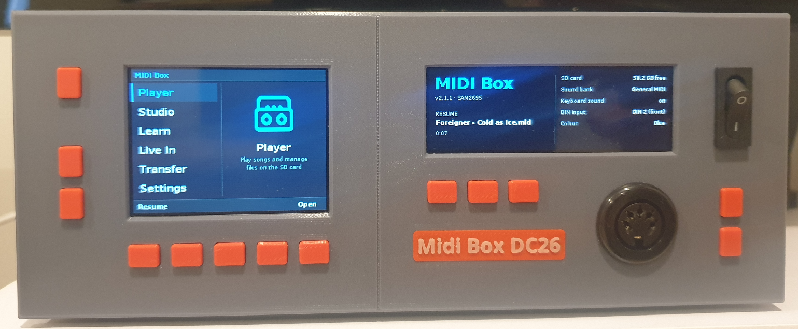
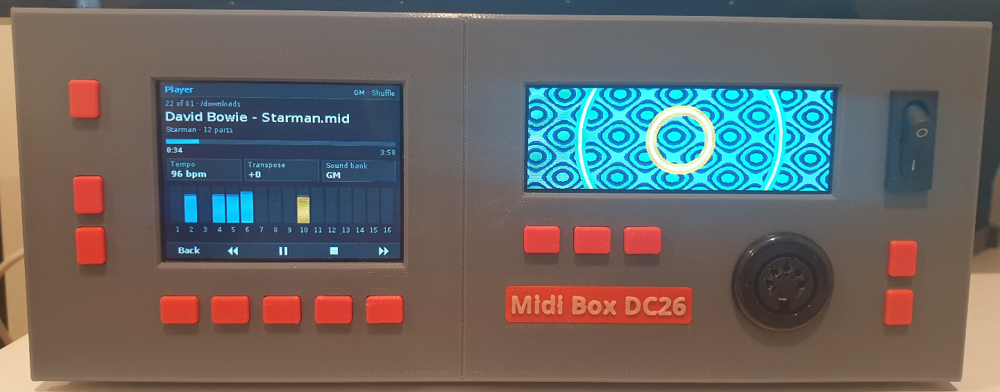

# MIDI Box

**Firmware 2.1.1**

The MIDI Box is a stand-alone music box built around an ESP32-S3 and a SAM2695 General MIDI synth.
It plays MIDI files from an SD card, lets you record and edit your own songs, teaches you to play
the piano, and shows the music on a second screen with 14 visualisers. Plug in a MIDI keyboard
(two DIN inputs or Bluetooth) and play it through the box's own sound.

- **Player**: plays .mid files with tempo, transpose, play modes, mute and solo.
- **Studio**: records, edits and exports your own songs, with or without a keyboard.
- **Learn**: Play Along, scales and chords, Note Reading and Ear Training, with scores and stars.
- **Live In**: play your keyboard through the synth.
- **Visualisers**: 14 ways to watch the music on the bar screen.
- **Transfer**: send songs from your PC to the box.

The home screen lists everything on screen 1. Screen 2 shows the firmware version, the song you can
resume, and the box's status: free space on the SD card, sound bank, keyboard sound, which DIN input
is in use and the display colour.

---

## The buttons

The buttons do the same thing on every screen.

| Button | What it does |
|---|---|
| 1 | **Shift**: hold it and the bottom row of screen 1 shows the Shift functions |
| 2 / 3 | Up / down (previous / next) |
| 4 – 8 | Soft keys, labelled along the bottom of screen 1. 4 is always **Back**, 8 the main action |
| 9 | Next visualiser on screen 2 (Shift + 9: previous) |
| 10 | Visualiser option (shape, speed, trails…) |
| 11 | Visualiser colour |
| 12 / 13 | Volume, from any screen |

---

## Player

Pick **Player** on the home screen to browse the SD card. The browser shows folders and MIDI files
and opens in the folder you last played from. From it you can play, copy, move, rename and delete
files, and make new folders.

While a song plays, screen 1 shows the title, its place in the folder, the time, the tempo,
transpose and sound bank, and a level meter for each of the 16 channels.

- **Play modes** (Shift + 4): **Once**, **Repeat**, **Folder** (play the whole folder) and
  **Shuffle** (the folder in a random order).
- **Tempo** 25 – 200 %, **Transpose** ±12 semitones (drums stay as they are).
- **Sound bank**: General MIDI or Roland MT-32.
- **Tracks** (Shift + 8): turn any part off with **Sound**, hear one part on its own with **Solo**,
  or hide a part from the visualisers.
- **Resume** on the home screen carries on where you left off.
- **Auto play** (in Settings) decides whether a song starts as soon as you open it or waits for Play.
- Files that can't be played say why: *This is not a MIDI file we can play*, *Incomplete file*,
  *Could not read the file* or *Not enough memory for this file*. In Folder and Shuffle the box
  moves on to the next song after 3 seconds.

---

## Studio

Make your own songs in **projects** of up to 16 tracks.

- Choose a track and play your DIN or Bluetooth keyboard: you hear that track's instrument.
- **Record** with a count-in, metronome and optional loop for building up a part in layers. Keep or
  discard each take, and undo the last pass.
- **Edit** on a piano roll: copy, cut, paste, delete, duplicate, transpose, change velocity, and
  **quantise** (1/4 to 1/32 and triplets, with strength and swing).
- **Notes**: change single notes, or type a whole tune in with the buttons, no keyboard needed.
  Screen 2 shows the track as notation with note names.
- **Song settings**: tempo, beats per bar, length, GM or MT-32. **Track settings**: instrument (with
  a preview as you scroll), name, channel, volume, mute and solo.
- **Export .mid** (Shift + 5) saves a standard MIDI file you can play in the Player or on a PC.

---

## Learn

Learn to play with your MIDI keyboard connected. The first time, press the lowest and highest key of
your keyboard so the box knows its range.

- **Play Along**: 15 built-in pieces, from *Twinkle Twinkle* and *Ode to Joy* to *Für Elise*,
  *Clair de Lune* and the *Moonlight Sonata* (several in full and easy versions), or any MIDI file
  from the SD card. Play the right hand, left hand or both while the box plays the rest.
  - **Wait mode** waits for you to play each note. **Play mode** keeps going and grades every note
    *Perfect*, *Good*, *Miss* or *Wrong*, with a combo score.
  - Choose the speed, starting bar and count-in, loop four bars, or show note names.
  - Screen 2 is the game: notes fall onto a keyboard the size of yours.
  - Results give 1 – 3 stars, your score, best combo and whether you tend to play early or late.
- **Exercises**: major and minor scales, chords and arpeggios in every key, with the right fingering
  on a grand staff, played along to a metronome. A steadiness meter shows if you rush or drag.
- **Note Reading**: a note appears on the staff; play it before time runs out. Ledger lines, and
  later sharps and flats, come in as you get better.
- **Ear Training**: the box plays, you answer: same or different, up or down, intervals, major or
  minor chords. New levels unlock as you go.
- **Practice stats** on the home screen: your last sessions, total time, stars and songs learnt.

---

## Live In

Play a keyboard through the box's synth. Choose the input (back or front DIN socket, or Bluetooth),
the sound bank and the instrument, which you hear as you scroll through them. The screen shows
activity on each channel and the last message received.

- **Keyboard sound** (Shift + 8, or in Settings) turns the synth on or off for your keyboard. With
  it off the visualisers still follow what you play.
- **Panic** stops every sounding note.
- **Bluetooth MIDI**: 5 reconnects the last device, Shift + 5 searches for a new one.

The **MIDI Thru** socket passes everything from MIDI In 1 (the back socket) straight on to other
gear.

---

## Visualisers

Screen 2 shows the music while you play or listen. Button 9 steps through them, button 10 changes
the option and button 11 the colour. Each one remembers its own settings.

| Visualiser | Button 10 | Button 11 |
|---|---|---|
| **Piano**: keys light up, with note names and how hard each was played | note names on / off | key colour |
| **Spectrum Analyser**: 16 bars from 31 Hz to 16 kHz, the way a real analyser would show the sound | peak line on / off | bar colour |
| **Staff**: the music scrolling on a grand staff | all channels or one | by channel or one colour |
| **Chords**: the chord name, its notes and the progression | all channels or one | colour |
| **Piano Roll**: notes scrolling past | speed | background |
| **Visualiser One** | blobs on / off | background |
| **Visualiser Two** | rings on / off | background |
| **Visualiser Three** | shape | background |
| **Visualiser Four** | shape | its own colours |
| **Pulse**: flowing plasma with rings for each note | ring shape | colour or Rainbow |
| **Fireworks**: a burst for every note under a starry sky | trails on / off | by channel or one colour |
| **Kaleidoscope**: mirrored shards for every note, rings for the drums | 6 / 8 / 12 slices | background |
| **Synthwave**: a retro sunset with mountains that move with the music | grid speed | theme: Classic, Outrun, Ice, Toxic |
| **Spirograph**: glowing curves shaped by the chords you play | trails on / off | colour or Rainbow |

The colours are Green, Blue, Amber, Purple, Pink, Cyan, Red and White. The last choice on button 11
is **Cycle**, which slowly fades from one colour to the next every 8 seconds.

---

## Getting songs onto the box

Copy .mid files onto the SD card with a card reader, in any folders you like, or send them from a
PC over Bluetooth:

- `extra/midi_box_transfer.py` sends one or more files from Linux or Windows.
  `--install` adds it to the right-click menu (Nemo on Linux, *Send to* on Windows).
  See `extra/midi_box_transfer.txt`.
- The box asks you to accept or decline, then saves the files in `/downloads`.

On the SD card:

| Folder | What's in it |
|---|---|
| any folder you like | your MIDI files (.mid) |
| `/downloads` | files sent from a PC |
| `/projects` | Studio projects (.mbp) and the .mid files you export |
| `/learn` | your keyboard range, best scores, stars and practice time |

---

## Settings

- **Display brightness** and **Display colour** (the highlight colour of the menus).
- **Sound bank**: General MIDI or Roland MT-32.
- **Keyboard sound**: play the MIDI inputs through the synth.
- **Auto play**: start a song as soon as it is opened, or wait for Play.
- **Visualiser**: which one is on screen 2.
- **About**: the firmware version.

---

*Credits: the Moonlight Sonata arrangements in Learn come from the Mutopia Project (CC BY-SA 2.5),
see `tools/learn_midi/CREDITS.txt`.*
