# MIDI Box

**Firmware 2.1.1**


The MIDI Box is a stand-alone music box built around an ESP32-S3 and a SAM2695 General MIDI synth.
It plays MIDI files from an SD card, lets you record and edit your own songs, teaches you to play
the piano, and shows the music on a second screen with 14 visualisers. Plug in a MIDI keyboard
(two DIN inputs or Bluetooth) and play it through the box's own sound.

- **Player**: plays .mid files with tempo, transpose, play modes, mute and solo.
- **Studio**: records, edits and exports your own songs, with or without a keyboard.
- **Learn**: Play Along, scales and chords, Note Reading and Ear Training, with scores and stars.
- **Live In**: play your keyboard through the synth.
- **Visualisers**: 14 ways to watch the music on the bar screen.
- **Transfer**: send songs from your PC to the box.

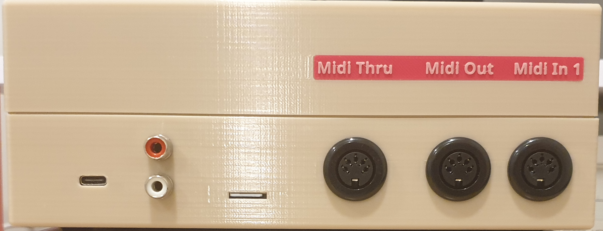

*The back, left to right: USB-C (power and computer), audio out (red = right, white = left), the
micro SD card slot, then MIDI Thru, MIDI Out and MIDI In 1. MIDI In 2 is on the front.*

The home screen lists everything on screen 1. Screen 2 shows the firmware version, the song you can
resume, and the box's status: free space on the SD card, sound bank, keyboard sound, which DIN input
is in use and the display colour.

---

## The buttons

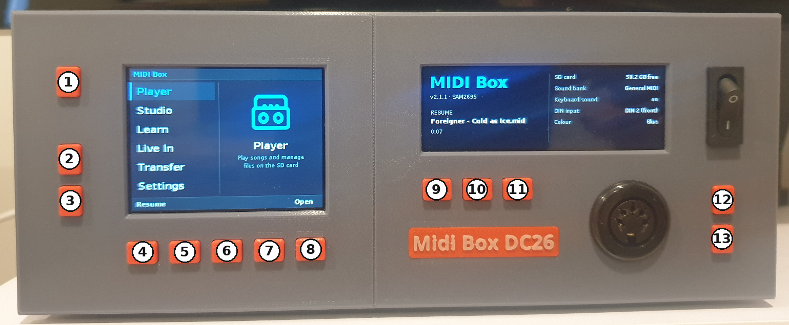

The buttons do the same thing on every screen.

| Button | Where it is | What it does |
|---|---|---|
| 1 | left of screen 1, the single button at the top | **Shift**: hold it and the bottom row of screen 1 shows the Shift functions |
| 2 / 3 | left of screen 1, the pair below it | Up / down (previous / next) |
| 4 – 8 | the row of five under screen 1, left to right | Soft keys, labelled along the bottom of screen 1. 4 is always **Back**, 8 the main action |
| 9 | under screen 2, left | Next visualiser on screen 2 (Shift + 9: previous) |
| 10 | under screen 2, middle | Visualiser option (shape, speed, trails…) |
| 11 | under screen 2, right | Visualiser colour |
| 12 / 13 | right of the MIDI socket, top and bottom | Volume up / down, from any screen |

Holding **button 1** while switching on puts the ESP32-S3 into programming mode (see
*Installing the firmware*).

---

## Player

Pick **Player** on the home screen to browse the SD card. The browser shows folders and MIDI files
and opens in the folder you last played from. From it you can play, copy, move, rename and delete
files, and make new folders.

While a song plays, screen 1 shows the title, its place in the folder, the time, the tempo,
transpose and sound bank, and a level meter for each of the 16 channels.


- **Play modes** (Shift + 4): **Once**, **Repeat**, **Folder** (play the whole folder) and
  **Shuffle** (the folder in a random order).
- **Tempo** 25 – 200 %, **Transpose** ±12 semitones (drums stay as they are).
- **Sound bank**: General MIDI or Roland MT-32.
- **Tracks** (Shift + 8): turn any part off with **Sound**, hear one part on its own with **Solo**,
  or hide a part from the visualisers.
- **Resume** on the home screen carries on where you left off.
- **Auto play** (in Settings) decides whether a song starts as soon as you open it or waits for Play.
- Files that can't be played say why: *This is not a MIDI file we can play*, *Incomplete file*,
  *Could not read the file* or *Not enough memory for this file*. In Folder and Shuffle the box
  moves on to the next song after 3 seconds.

---

## Studio

Make your own songs in **projects** of up to 16 tracks.

- Choose a track and play your DIN or Bluetooth keyboard: you hear that track's instrument.
- **Record** with a count-in, metronome and optional loop for building up a part in layers. Keep or
  discard each take, and undo the last pass.
- **Edit** on a piano roll: copy, cut, paste, delete, duplicate, transpose, change velocity, and
  **quantise** (1/4 to 1/32 and triplets, with strength and swing).
- **Notes**: change single notes, or type a whole tune in with the buttons, no keyboard needed.
  Screen 2 shows the track as notation with note names.
- **Song settings**: tempo, beats per bar, length, GM or MT-32. **Track settings**: instrument (with
  a preview as you scroll), name, channel, volume, mute and solo.
- **Export .mid** (Shift + 5) saves a standard MIDI file you can play in the Player or on a PC.

---

## Learn

Learn to play with your MIDI keyboard connected. The first time, press the lowest and highest key of
your keyboard so the box knows its range.

- **Play Along**: 15 built-in pieces, from *Twinkle Twinkle* and *Ode to Joy* to *Für Elise*,
  *Clair de Lune* and the *Moonlight Sonata* (several in full and easy versions), or any MIDI file
  from the SD card. Play the right hand, left hand or both while the box plays the rest.
  - **Wait mode** waits for you to play each note. **Play mode** keeps going and grades every note
    *Perfect*, *Good*, *Miss* or *Wrong*, with a combo score.
  - Choose the speed, starting bar and count-in, loop four bars, or show note names.
  - Screen 2 is the game: notes fall onto a keyboard the size of yours.
  - Results give 1 – 3 stars, your score, best combo and whether you tend to play early or late.
- **Exercises**: major and minor scales, chords and arpeggios in every key, with the right fingering
  on a grand staff, played along to a metronome. A steadiness meter shows if you rush or drag.
- **Note Reading**: a note appears on the staff; play it before time runs out. Ledger lines, and
  later sharps and flats, come in as you get better.
- **Ear Training**: the box plays, you answer: same or different, up or down, intervals, major or
  minor chords. New levels unlock as you go.
- **Practice stats** on the home screen: your last sessions, total time, stars and songs learnt.

---

## Live In

Play a keyboard through the box's synth. Choose the input (back or front DIN socket, or Bluetooth),
the sound bank and the instrument, which you hear as you scroll through them. The screen shows
activity on each channel and the last message received.

- **Keyboard sound** (Shift + 8, or in Settings) turns the synth on or off for your keyboard. With
  it off the visualisers still follow what you play.
- **Panic** stops every sounding note.
- **Bluetooth MIDI**: 5 reconnects the last device, Shift + 5 searches for a new one.

The **MIDI Thru** socket passes everything from MIDI In 1 (the back socket) straight on to other
gear.

---

## Visualisers

Screen 2 shows the music while you play or listen. Button 9 steps through them, button 10 changes
the option and button 11 the colour. Each one remembers its own settings.

| Visualiser | Button 10 | Button 11 |
|---|---|---|
| **Piano**: keys light up, with note names and how hard each was played | note names on / off | key colour |
| **Spectrum Analyser**: 16 bars from 31 Hz to 16 kHz, the way a real analyser would show the sound | peak line on / off | bar colour |
| **Staff**: the music scrolling on a grand staff | all channels or one | by channel or one colour |
| **Chords**: the chord name, its notes and the progression | all channels or one | colour |
| **Piano Roll**: notes scrolling past | speed | background |
| **Visualiser One** | blobs on / off | background |
| **Visualiser Two** | rings on / off | background |
| **Visualiser Three** | shape | background |
| **Visualiser Four** | shape | its own colours |
| **Pulse**: flowing plasma with rings for each note | ring shape | colour or Rainbow |
| **Fireworks**: a burst for every note under a starry sky | trails on / off | by channel or one colour |
| **Kaleidoscope**: mirrored shards for every note, rings for the drums | 6 / 8 / 12 slices | background |
| **Synthwave**: a retro sunset with mountains that move with the music | grid speed | theme: Classic, Outrun, Ice, Toxic |
| **Spirograph**: glowing curves shaped by the chords you play | trails on / off | colour or Rainbow |

The colours are Green, Blue, Amber, Purple, Pink, Cyan, Red and White. The last choice on button 11
is **Cycle**, which slowly fades from one colour to the next every 8 seconds.

---

## Getting songs onto the box

Copy .mid files onto the SD card with a card reader, in any folders you like, or send them from a
PC over Bluetooth:

- `extra/midi_box_transfer.py` sends one or more files from Linux or Windows.
  `--install` adds it to the right-click menu (Nemo on Linux, *Send to* on Windows).
  See `extra/midi_box_transfer.txt`.
- The box asks you to accept or decline, then saves the files in `/downloads`.

On the SD card:

| Folder | What's in it |
|---|---|
| any folder you like | your MIDI files (.mid) |
| `/downloads` | files sent from a PC |
| `/projects` | Studio projects (.mbp) and the .mid files you export |
| `/learn` | your keyboard range, best scores, stars and practice time |

---

## Settings

- **Display brightness** and **Display colour** (the highlight colour of the menus).
- **Sound bank**: General MIDI or Roland MT-32.
- **Keyboard sound**: play the MIDI inputs through the synth.
- **Auto play**: start a song as soon as it is opened, or wait for Play.
- **Visualiser**: which one is on screen 2.
- **About**: the firmware version.

---

## Building a MIDI Box

Everything plugs into one main board: the ESP32-S3 board sits on it, and every other part connects
to it with a 2-pin to 8-pin lead. You need to be comfortable soldering through-hole parts (and one
small surface-mount transistor).

### What you need

**Modules and panel parts**

| | Qty | Part | Used for |
|---|---|---|---|
| 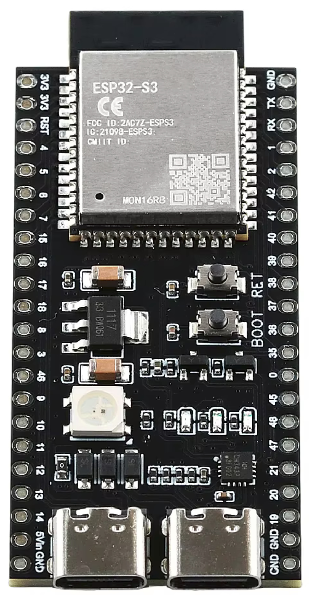 | 1 | ESP32-S3 Development Board N16R8, 44 pin (DevKitC-1) | the brain |
| 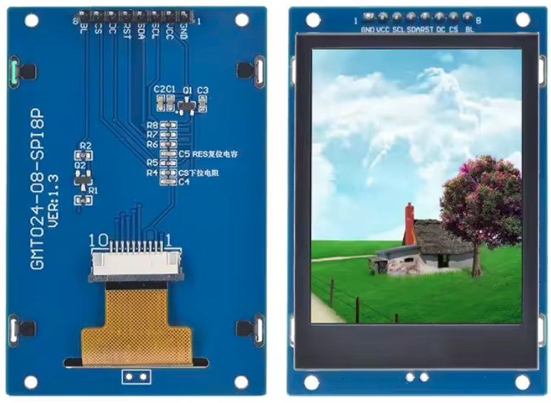 | 1 | 2.4" 240 × 320 TFT LCD module (ST7789V, SPI, 8 pins) | screen 1 |
| 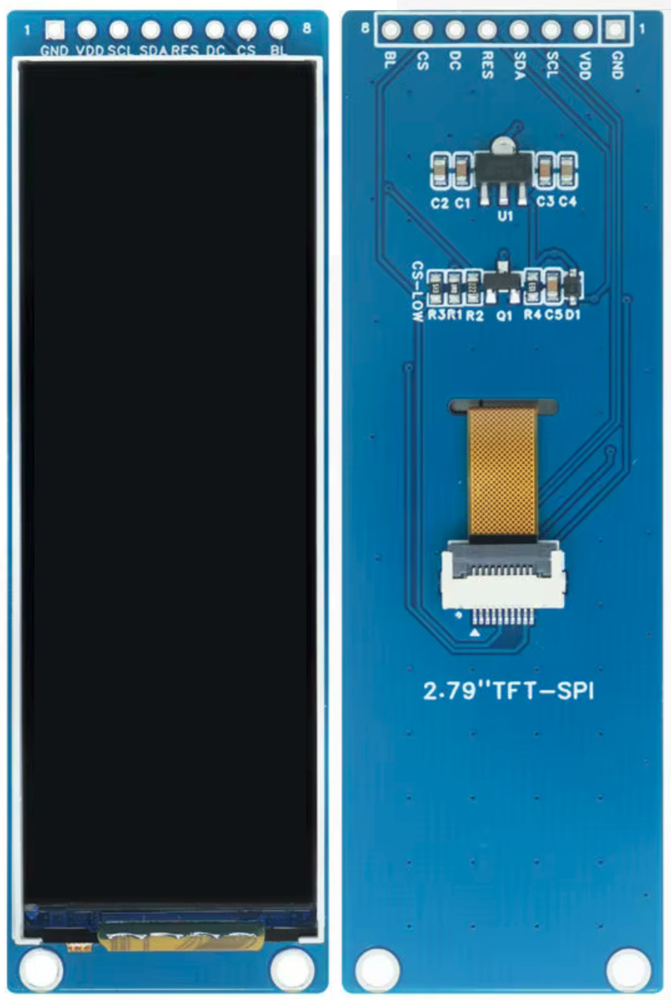 | 1 | 2.79" 142 × 428 bar-type IPS TFT LCD module (NV3007, SPI, 8 pins) | screen 2 |
| 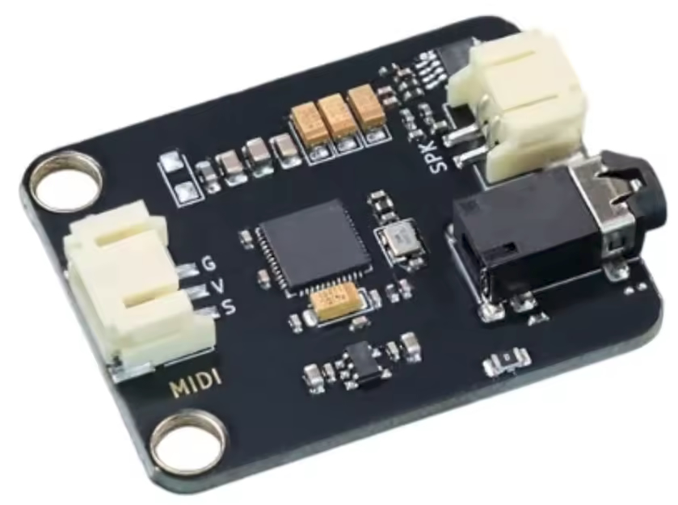 | 1 | MIDI Digital Music Module SAM2695 | the synth |
| 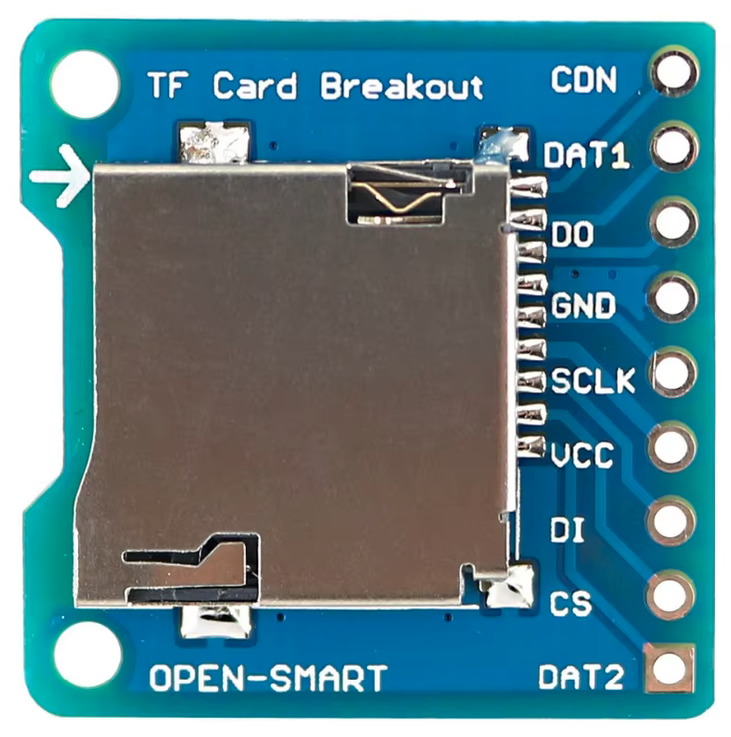 | 1 | Micro SD card module (Open-Smart "TF Card Breakout") | songs and settings |
| 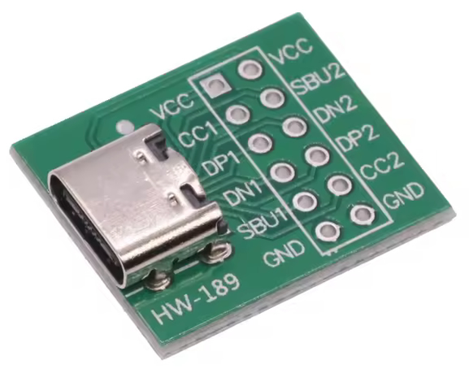 | 1 | USB Type-C female to DIP breakout board (HW-189) | power and USB |
| 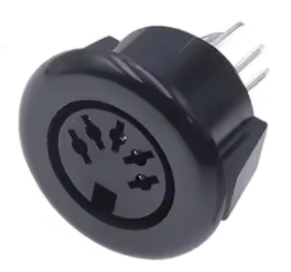 | 4 | DIN 5-pin female round vertical socket | MIDI In 1, In 2, Out, Thru |
|  | 2 | Female RCA panel-mount socket (red and white) | audio out |
| 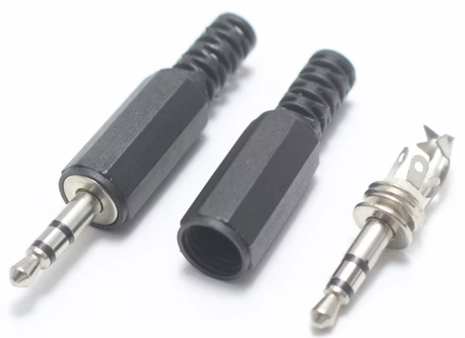 | 1 | 3.5 mm stereo audio plug | from the synth to the RCA sockets |
| 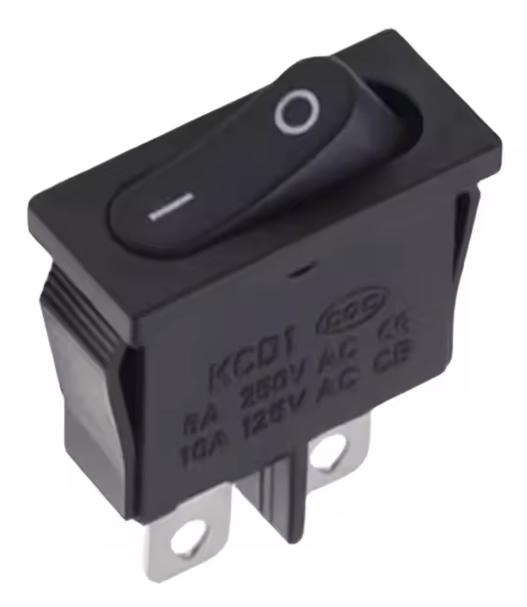 | 1 | 10 × 21 mm rocker switch KCD1 | power |
| 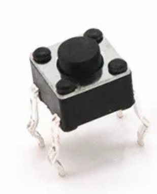 | 13 | Mini push button, 4.5 × 4.5 × 3.8 mm | the 13 buttons |

**Main board parts** (resistors ¼ W)

| Qty | Part | Where |
|---|---|---|
| 2 | 6N137 optocoupler (DIP-8) and a DIP-8 socket for each | IC1 MIDI In 2, IC2 MIDI In 1 |
| 1 | SN74HCT14N hex Schmitt trigger (DIP-14) and a DIP-14 socket | IC3 MIDI Out and Thru |
| 1 | AO3401A P-channel MOSFET (SOT-23, surface mount) | Q1 screen backlight |
| 4 | 10 kΩ resistor | R1, R2, R4, R6 |
| 6 | 220 Ω resistor | R3, R5, R7, R8, R9, R10 |
| 2 | 1N4148 diode | D1, D2 |
| 3 | 100 nF ceramic capacitor | C1, C2, C3 (one beside each chip) |
| 2 | 5.1 kΩ resistor | on the USB-C breakout (see below) |
| 2 | 1 × 22 female header, 2.54 mm | for the ESP32-S3 board |
| 2 | 1 × 8 female header | J7, J8 screens |
| 2 | 1 × 6 female header | J2 buttons 4–8, J9 SD card |
| 3 | 1 × 4 female header | J1 buttons 1–3, J3 buttons 9–11, J10 USB-C |
| 2 | 1 × 3 female header | J4 buttons 12–13, J6 synth |
| 5 | 1 × 2 female header | J5 power switch, J11 – J14 MIDI sockets |
| 1 | 90 × 70 mm prototype board, 2.54 mm pitch | the main board |
| – | small pieces of prototype board | four strips for the buttons, and one to mount the USB-C breakout |

**Screws**

| Qty | Screw | Used for |
|---|---|---|
| 25 | M2 × 6 mm | all the parts inside: screens, button strips, main board, USB-C board, SAM2695, SD module |
| 8 | M3 × 8 mm button head | front panel to the case |
| 6 | M3 × 25 mm socket cap head | case top to case bottom |

You also need the 3D-printed case and parts (see [The case](#the-case)), leads with 2.54 mm pins or
housings to join each part to its header (Dupont leads, crimped housings or wire soldered to header
pins all work), a micro SD card, and a USB-C power supply or cable.

### The main board

Build the board on a standard **90 × 70 mm prototype board**: the case's screw holes are made to
fit it (four M2 holes, 2 mm in from each corner, 86 × 66 mm apart). A PCB design of the same board
is included too, but it has not been made or tested yet: see
[*The PCB (work in progress)*](#the-pcb-work-in-progress) below.

**Circuit**

*MIDI In 1 and 2, MIDI Out and MIDI Thru:*

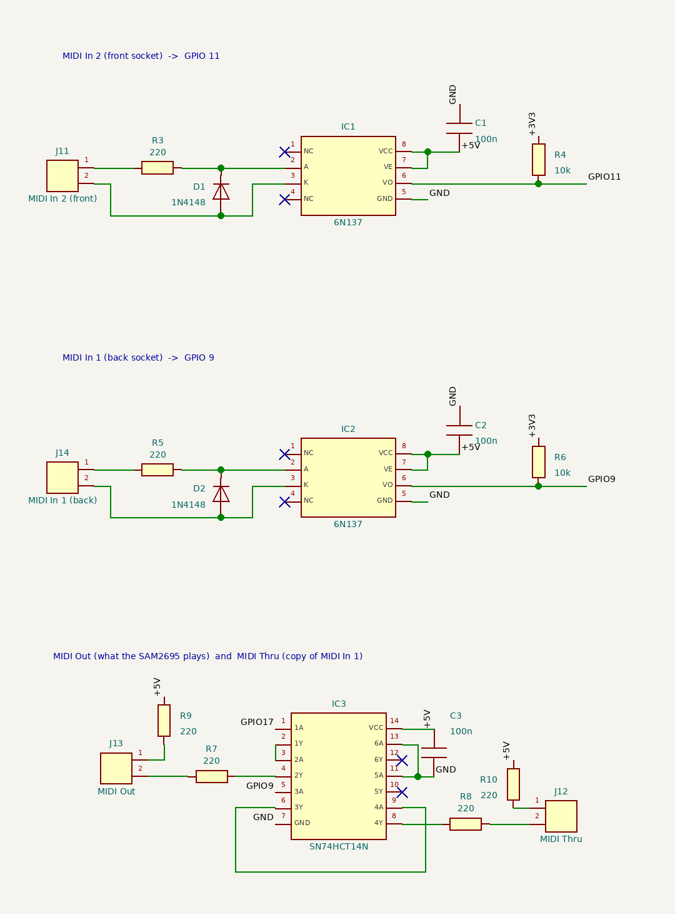

*The ESP32-S3 board, the GPIO0 pull-up and the screen backlight switch:*

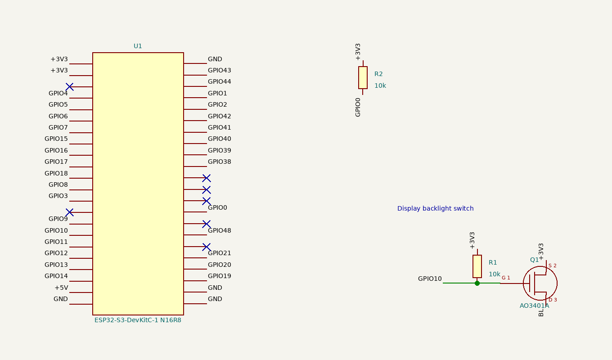

*The connectors, pin 1 at the top of each:*

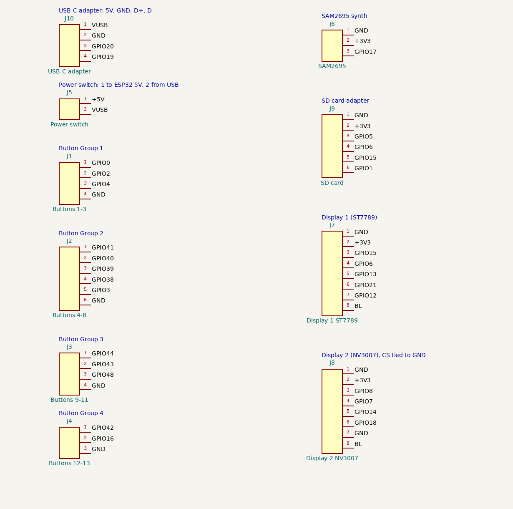

Labels with the same name are joined: every `GPIO17` is one wire, every `GND` is one wire, and so on.
The ESP32-S3 board supplies the 3.3 V; the 5 V comes from the USB-C socket through the power switch.

**The prototype board build (tested)**

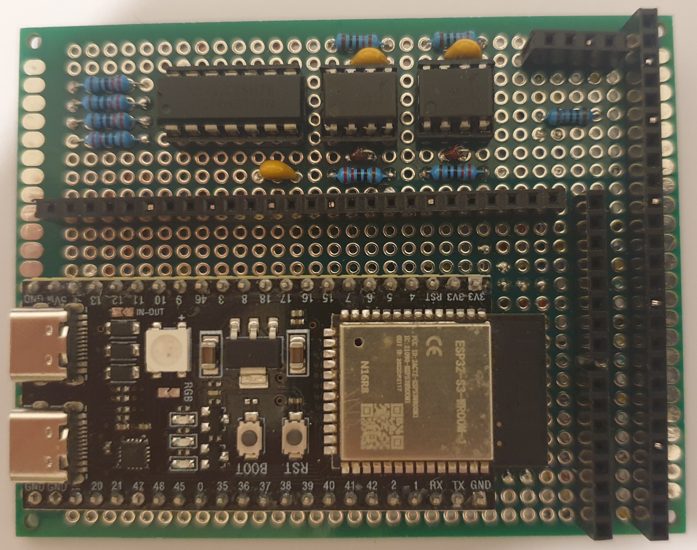

*The ESP32-S3 board runs along the bottom, USB end on the left and its antenna on the right, clear
of everything else. The 74HCT14 (left) and the two 6N137s sit in sockets along the top, each with
its 100 nF capacitor beside it and its resistors and diode next to it. The connector headers are a
long row across the middle and two columns down the right-hand side. The AO3401A is on the
underside, so you can't see it here.*

Keep the area to the right of the ESP32-S3 board's antenna free of wires and copper, so Bluetooth
works well.

**PCB layout** (top view, the square pad is pin 1 of each part). This is how the parts sit on the
PCB design. It is laid out differently from the prototype board above, and you don't have to copy
either one exactly: any layout that makes the connections in the circuit works.

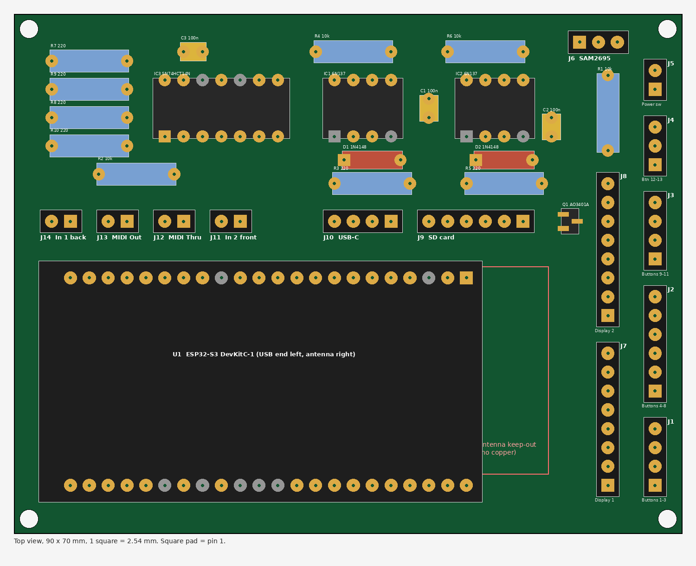

**Soldering order**

1. **Q1** (AO3401A) first, while the board is flat: pin 1 (gate) to R1 and GPIO10, pin 2 (source)
   to 3.3 V, pin 3 (drain) to the BL pin of both screen headers. On a prototype board it can go on
   the **underside**, as in the photo; its three pins still connect the same way.
2. **Resistors** and **diodes**. Each 1N4148 goes across the LED of its 6N137, with the **band
   (cathode) to pin 2** and the other end to pin 3.
3. **IC sockets**, with the notch at pin 1, then the **capacitors**, each from 5 V to GND right next
   to its chip.
4. **Headers**: the two 1 × 22 rows for the ESP32-S3 board (11 holes apart, 27.94 mm), then the
   connector headers.
5. Check every joint, then fit the chips into their sockets, notch to notch.

### The PCB (work in progress)

> ⚠️ **Not tested.** This PCB has not been manufactured or tried in a MIDI Box yet. It is shared so
> you can see where the project is going, check it, or improve it. If you order it, you do so at your
> own risk. The prototype-board build above is the one that is known to work.

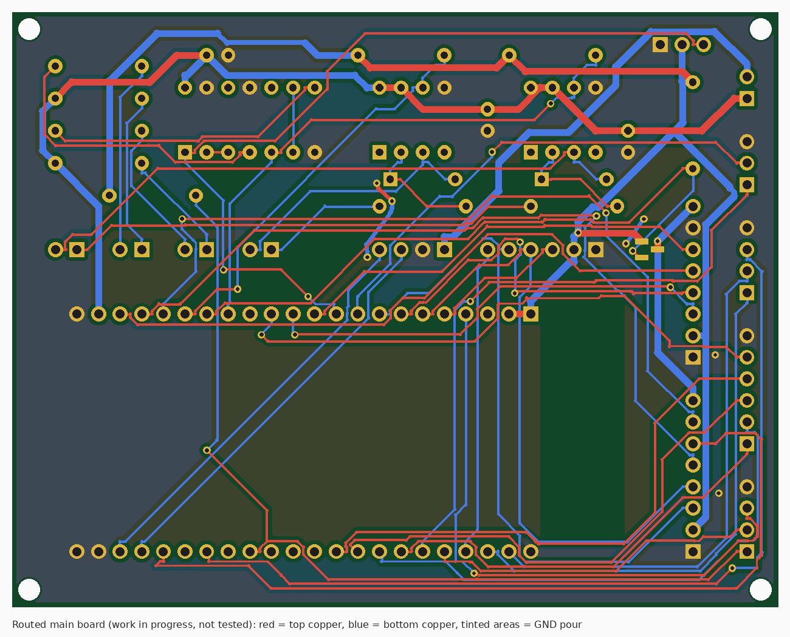

The KiCad project is in [`hardware/main_board/`](hardware/main_board/):

| File | What it is |
|---|---|
| `midibox_main.kicad_sch` | the circuit (the same as the pictures above) |
| `midibox_main.kicad_pcb` | the 90 × 70 mm, 2-layer board, routed, with a ground pour on both sides |
| `midibox_main.kicad_pro` | the KiCad project with the track widths and clearances |
| `BOM.csv` | the parts on the board |
| `WIRING.md` | every connection, net by net |

It uses the same parts, the same connectors and the same pin order as the prototype-board build, so
everything else in this guide applies to it. The four M2 holes are in the same places.

**Where it stands**

- It was drawn and routed in KiCad 10 and passes its design-rule check with these known exceptions:
  - Some resistor, diode and capacitor outlines overlap slightly on paper. The real parts sit about
    1 mm apart.
  - One GND pin of the ESP32-S3 board (the bottom row, at the right-hand end) is not joined to
    the board's ground, because it sits next to the antenna area, which is kept free of copper.
    The ESP32-S3 board joins all its GND pins itself.
  - The pin labels on the silkscreen are a little smaller than some makers like (0.7 mm).
- Nothing on the board has been checked on real hardware: the footprints against your actual
  parts, the ESP32-S3 board's two pin rows (27.94 mm apart), the MOSFET's pinout, or the board
  in the case.

**If you want to try it**

1. Open the project in KiCad and run **Inspect → Design Rules Checker** yourself.
2. Compare each footprint with the parts you have, especially the ESP32-S3 board and Q1 (AO3401A).
3. Make the Gerbers and drill files with **File → Fabrication Outputs**. The board is 2 layers,
   90 × 70 mm, 1.6 mm thick.
4. Please share what you find. Corrections will go into a tested version.

### Connecting the parts

Pin 1 of each header is the square pad in the layout above. All the button and screen headers have
pin 1 (and GND) at the bottom.

**Screens**: both modules have the same 8 pins in the same order, so each plugs in pin for pin.

| Header pin | 1 | 2 | 3 | 4 | 5 | 6 | 7 | 8 |
|---|---|---|---|---|---|---|---|---|
| Screen pin | GND | VCC / VDD | SCL | SDA | RES | DC | CS | BL |
| J7 screen 1 (2.4") | GND | 3.3 V | GPIO15 | GPIO6 | GPIO13 | GPIO21 | GPIO12 | backlight |
| J8 screen 2 (2.79") | GND | 3.3 V | GPIO8 | GPIO7 | GPIO14 | GPIO18 | GND | backlight |

**SD card module (J9)**: 6 of its 9 pins. Leave CDN, DAT1 and DAT2 unconnected.

| J9 pin | 1 | 2 | 3 | 4 | 5 | 6 |
|---|---|---|---|---|---|---|
| Module pin | GND | VCC | DO | DI | SCLK | CS |

**Synth (J6)**: to the SAM2695's 3-pin **MIDI** connector: pin 1 → **G**, pin 2 → **V**,
pin 3 → **S**.

**Audio**: solder a short cable from the 3.5 mm plug to the two RCA sockets and plug it into the
SAM2695's headphone jack:

- **Tip** → left RCA (white)
- **Ring** → right RCA (red)
- **Sleeve** → the ground tag of both RCA sockets

**USB-C (J10)**: the breakout is soldered by its header pins onto a small piece of prototype board,
which is screwed into the case behind the USB-C hole.

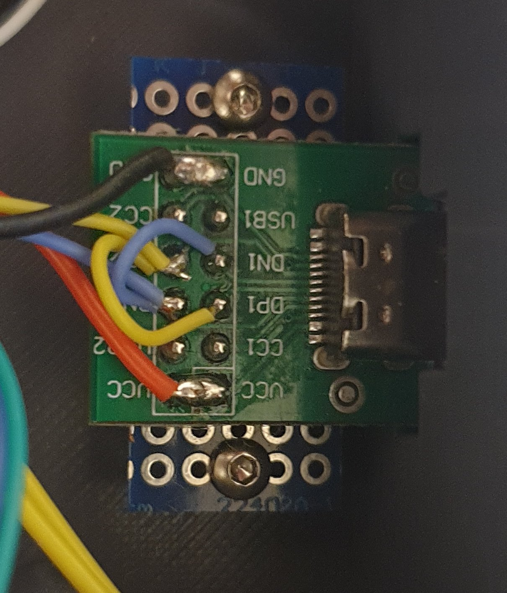

The HW-189 has 12 pins in two columns (rows counted from the GND end):

| Row | Inner column (next to the labels) | Outer column |
|---|---|---|
| 1 | GND | GND |
| 2 | SBU1 | **CC2** |
| 3 | DN1 | DP2 |
| 4 | DP1 | DN2 |
| 5 | **CC1** | SBU2 |
| 6 | VCC | VCC |

1. On the mounting board, solder **one 5.1 kΩ resistor from CC1 to GND** and **another from CC2 to
   GND**. Use two separate resistors. Without them a USB-C charger or a C-to-C cable won't switch the
   5 V on.
2. Join the two **GND** pins, and the two **VCC** pins.
3. Link **DN1 to DN2** and **DP1 to DP2** (the short blue and yellow links in the photo) so the plug
   works either way up. Leave SBU1 and SBU2 unconnected.
4. Connect it to J10:

| J10 pin | 1 | 2 | 3 | 4 |
|---|---|---|---|---|
| Breakout | VCC | GND | DP (D+) | DN (D−) |

**Power switch (J5)**: the rocker switch goes between pin 1 (the ESP32-S3 board's 5 V) and pin 2
(5 V from the USB-C socket).

**Back panel**: this is where each socket goes (seen from the back of the box). MIDI In 2 is the
one on the front panel.


**MIDI sockets**: two wires each. Header **pin 1 → DIN pin 4**, **pin 2 → DIN pin 5**. Pin 2 of the
DIN socket is the centre one, with 4 and 5 either side of it; check the numbers on your socket.

| Header | Socket |
|---|---|
| J14 | MIDI In 1 (back) |
| J11 | MIDI In 2 (front) |
| J13 | MIDI Out |
| J12 | MIDI Thru |

**Buttons**: numbered as in the picture under *The buttons*. Each button goes between its pin and
the GND pin of the same header. The 4-pin push
buttons are joined in pairs inside, so use two pins on opposite corners.

| Header | Pin 1 | Pin 2 | Pin 3 | Pin 4 | Pin 5 | Last pin |
|---|---|---|---|---|---|---|
| J1 | button 1 (Shift) | button 2 (up) | button 3 (down) | GND | | |
| J2 | button 4 (Back) | button 5 | button 6 | button 7 | button 8 | GND |
| J3 | button 9 | button 10 | button 11 | GND | | |
| J4 | button 12 | button 13 | GND | | | |

Label each lead as you make it, and keep each connector's leads together in a bundle held with a
couple of small clips. It keeps the inside tidy, and you can follow every lead when checking it.

### The case

The case and its small parts are 3D printed. The print files are in
[`hardware/case/`](hardware/case/); the screws are listed under [What you need](#what-you-need).

| File | Print | What it's for |
|---|---|---|
| `case_bottom.stl` | 1 | bottom half of the case |
| `case_top.stl` | 1 | top half of the case |
| `case_front.stl` | 1 | front panel |
| `button_main.stl` | 13 | button caps (see the note below) |
| `button_small_tolerance.stl` | – | looser button cap, only if needed |
| `button_high_tolerance.stl` | – | loosest button cap, only if needed |
| `midi_module_bottom_mount.stl` | 1 | goes under the SAM2695 module |
| `midi_module_top_washer.stl` | 2 | go on top of the SAM2695 module, under the screw heads |
| `screen_2_clamp.stl` | 1 | holds down the side of screen 2 that has no mounting holes |
| `sd_card_gap_fill.stl` | 1 | glued to the SD card module (see below) |
| `front_label_plate.stl` | 1 | front label |
| `back_label_plate.stl` | 1 | back label |

- **Button caps:** print one `button_main` first and try it. If it doesn't move freely when you
  press it, try `button_small_tolerance`, and if that is still tight, `button_high_tolerance`. Then
  print all 13 in the size that works.
- **SAM2695 module:** its mounting holes are extra large, so a screw head alone won't hold it. Fit
  the printed bottom mount under the module and a top washer over each hole.
- **SD card gap fill:** glue it to the SD card module. It closes the gap between the module and the
  case, so a card can't be pushed into the case instead of into the module's slot.
- **Tip:** for a perfect alignment of the screens in the front panel, you can enlarge the mounting
  holes on the LCD screen boards slightly. This gives each screen a little room to move so you can
  line it up exactly before tightening the screws.

**The front panel**

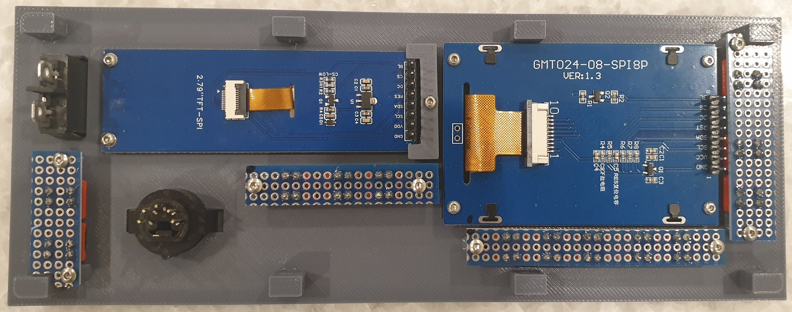

*Seen from behind, so left and right are swapped. The two screens are screwed to the panel; the
2.79" bar screen has a printed holder over its 8-pin header. The buttons are soldered onto four
small strips of prototype board, each held by two screws, with the buttons pushing through the
panel under the red caps: buttons 1–3 (on the right here), 4–8 (long strip at the bottom), 9–11
(middle strip) and 12–13 (small strip on the left). MIDI In 2 and the power switch are mounted
straight into the panel.*

**Fitting it into the case**

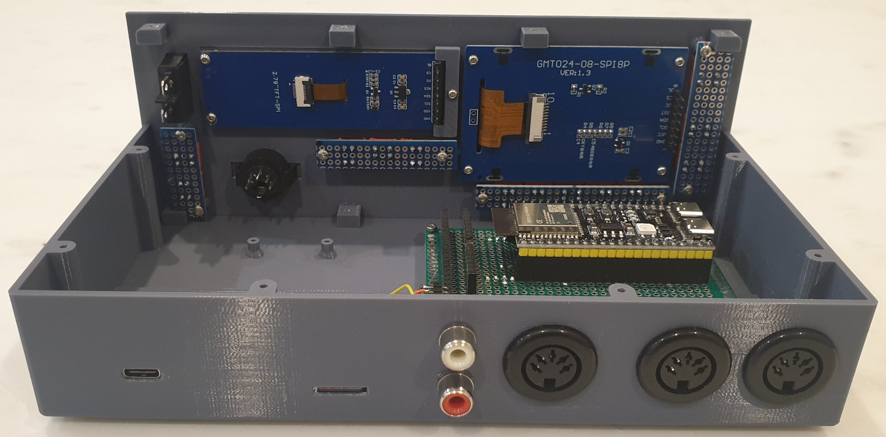

*First, before any wiring: the front panel is fitted, and the main board with the ESP32-S3 sits in
the base. The two posts on the left are for the SAM2695 module. On the back panel, from the left:
USB-C, the SD slot, the RCA sockets, and the three MIDI sockets. The RCA sockets can go either way
up, as long as the plug's tip goes to the white one and its ring to the red one.*

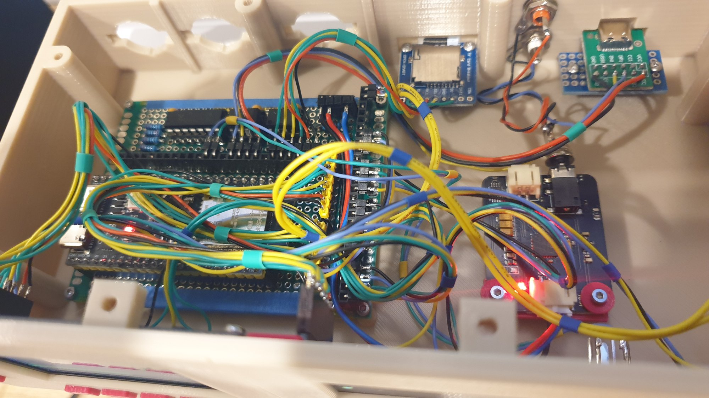

*Then everything wired up. The SD module, RCA sockets and USB-C breakout are fixed along the back
wall, the SAM2695 is screwed down on spacers on the right, and each connector's leads run to the
main board in their own clipped bundle.*

### Installing the firmware

1. Download the `.bin` file from the releases page.
2. Download **esptool** from https://github.com/espressif/esptool/releases.
3. Hold **button 1** while switching the box on to put it into programming mode, then connect the
   box's USB-C socket to your computer.
4. Flash the image:

   **Windows**
   ```
   esptool.exe --chip esp32s3 write-flash 0x0 "Midi_Box_*.bin"
   ```
   **Linux**
   ```
   ./esptool --chip esp32s3 write-flash 0x0 Midi_Box_*.bin
   ```
   If esptool can't find the box, add the `--port` option, for example `--port COM5` on Windows or
   `--port /dev/ttyACM0` on Linux.
5. Switch the box off and on again.

**Building it yourself:** install ESP-IDF 6.0, then run `idf.py set-target esp32s3` and
`idf.py build flash`.

You can also flash the ESP32-S3 board through its own USB-C ports before it goes into the box. In
the finished box those ports aren't used.

### First switch-on

- Both screens light up after a moment: the home menu on screen 1 and the status on screen 2.
- **A screen stays dark or white**: check its 8 wires, the 3.3 V, and the backlight (BL) wire.
- **A button does nothing**: check the GND wire of its header.
- **No sound**: check the synth's G / V / S wiring and the audio cable, and press button 12 to turn
  the volume up.
- **MIDI keyboard not heard**: open **Live In**; if the activity lights don't move, swap the two
  wires of that MIDI socket.
- **SD card: no card** on screen 2: check the 6 SD wires and that the card is FAT32.

**Tip: power it from a USB adapter.** A computer's USB port often can't supply enough current for the
MIDI Box. If it can't, the box will now and then reset itself (a "brownout"). For normal use, run it
from a USB wall adapter. If your computer can't power it reliably, only use the computer while you're
putting the firmware on.

### The SD card

Use a micro SD card formatted as **FAT32**. Copy your MIDI files into any folders you like; the box
makes its own folders (`/downloads`, `/projects`, `/learn`) when it needs them.

---

*Credits: the Moonlight Sonata arrangements in Learn come from the Mutopia Project (CC BY-SA 2.5),
see `tools/learn_midi/CREDITS.txt`.*
